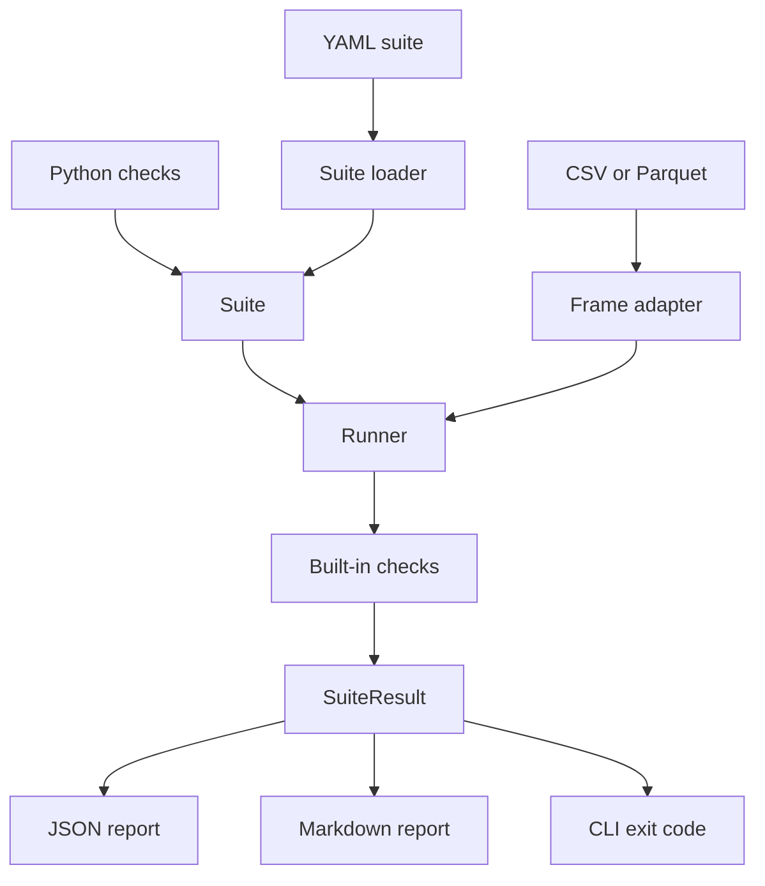

# pydq-toolkit

[](https://github.com/ikrompro/pydq-toolkit/actions/workflows/ci.yml)
[](https://github.com/ikrompro/pydq-toolkit/actions/workflows/ci.yml)
[](https://github.com/ikrompro/pydq-toolkit)
[](LICENSE)
[](https://github.com/astral-sh/ruff)

Declarative data-quality checks for tables you already have in pandas or polars.
Point a suite at a DataFrame, or at a CSV/Parquet file from CI, and get a
pass/fail result with failing-row counts and a short sample. A failed check
exits non-zero so the same suite can gate a pipeline.

pydq-toolkit does not run a service, store historical metrics, or require
anything beyond Python and pandas. Suites are code or YAML you can review in
pull requests.

## Install

```bash
pip install pydq-toolkit
```

The package is publish-ready and is not on PyPI yet. Until it is published,
install from a checkout:

```bash
pip install -e ".[dev]"
```

Optional readers:

```bash
pip install "pydq-toolkit[polars]"
pip install "pydq-toolkit[parquet]"
```

Python 3.10, 3.11, and 3.12 are supported.

## Quickstart

```python
import pandas as pd
from pydq import Suite, in_range, not_null, referential_integrity, unique

orders = pd.DataFrame(
    {
        "order_id": [1, 2],
        "customer_id": [10, 10],
        "amount": [25.0, 40.0],
    }
)
customers = pd.DataFrame({"customer_id": [10, 11]})
suite = Suite(
    "quickstart",
    [
        not_null("order_id"),
        unique("order_id"),
        in_range("amount", minimum=0, maximum=1000),
        referential_integrity("customer_id", ref="customers", ref_column="customer_id"),
    ],
)
result = suite.run(orders, {"customers": customers})
print(result.to_markdown())
assert result.passed
```

`examples/python_quickstart.py` is the same suite and prints the Markdown report.

## YAML suite

```yaml
version: 1
name: orders_quality
sample_size: 5
as_of: "2026-10-16T12:00:00Z"
checks:
  - type: not_null
    column: order_id
  - type: unique
    column: order_id
  - type: in_range
    column: amount
    min: 0
    max: 10000
  - type: allowed_values
    column: status
    values: [pending, shipped, delivered]
  - type: regex_match
    column: email
    pattern: '^[^@\s]+@[^@\s]+\.[^@\s]+$'
  - type: row_count_between
    min: 1
    max: 1000
  - type: freshness
    column: ordered_at
    max_age: 48h
  - type: schema
    columns:
      order_id: int64
      amount: float64
      status: string
  - type: referential_integrity
    column: customer_id
    ref: customers
    ref_column: customer_id
```

`regex_match` uses a full-string match. Bounds on `in_range` and
`row_count_between` are inclusive. `as_of` fixes the freshness clock so a
checked-in suite does not rot as the wall clock moves. Omit it to compare
against the current UTC time.

Load the same document from Python with `load_suite("suite.yaml")` or
`suite_from_dict`.

## CLI

```bash
pydq run examples/suite.yaml \
  --data examples/orders.csv \
  --ref customers=examples/customers.csv
```

Exit codes:

| Code | Meaning |
| --- | --- |
| 0 | Every check passed |
| 1 | At least one check failed |
| 2 | The suite or an input file could not be loaded |

Useful flags: `--format json`, `--output report.md`, `--sample-size 20`,
`--as-of 2026-10-16T12:00:00Z`, `--engine polars`, `--quiet`.

```bash
pydq run examples/suite.yaml \
  --data examples/orders_invalid.csv \
  --ref customers=examples/customers.csv \
  --format json \
  --output report.json
```

Parquet works when `pyarrow` is installed (`--data table.parquet`). The
synthetic files in `examples/` are generated by `examples/generate_dataset.py`.
They are not real customers.

## Sample report

`examples/orders.csv` passes and the process exits 0. The same suite against
`examples/orders_invalid.csv` exits 1. This is that failure report, including
the failing-row samples:

```text
# Data quality report: orders_quality

**Result:** FAIL
**Checks:** 3 passed, 7 failed, 10 total
**Backend:** pandas
**Started:** 2026-10-16T11:44:44.414179+00:00
**Finished:** 2026-10-16T11:44:44.427514+00:00

| Check | Type | Status | Failing rows | Total rows | Message |
| --- | --- | --- | ---: | ---: | --- |
| order_id is present | not_null | PASS | 0 | 9 | All 9 values in 'order_id' are non-null. |
| email is present | not_null | FAIL | 1 | 9 | 1 of 9 values in 'email' is null. |
| unique(order_id) | unique | FAIL | 2 | 9 | 2 of 9 rows are duplicates on 'order_id'. |
| in_range(amount) | in_range | FAIL | 1 | 9 | 1 of 9 values in 'amount' is outside [0, 10000]. |
| allowed_values(status) | allowed_values | FAIL | 1 | 9 | 1 of 9 values in 'status' is not allowed. |
| regex_match(email) | regex_match | FAIL | 1 | 9 | 1 of 9 values in 'email' does not match the pattern. |
| row_count_between(rows) | row_count_between | PASS | 0 | 9 | Row count 9 is inside [1, 1000]. |
| freshness(ordered_at) | freshness | FAIL | 9 | 9 | Latest timestamp in 'ordered_at' is 2020-06-02T11:00:00+00:00, older than 48h before 2026-10-16T12:00:00+00:00. |
| schema(columns) | schema | PASS | 0 | 9 | Columns match the expected schema. |
| referential_integrity(customer_id -> customers.customer_id) | referential_integrity | FAIL | 1 | 9 | 1 of 9 values in 'customer_id' is missing from customers.customer_id. |

## Failures

### email is present

1 of 9 values in 'email' is null.

Sample failing rows:

| order_id | customer_id | amount | status | email | ordered_at |
| --- | --- | --- | --- | --- | --- |
| 2007 | 6 | 40.0 | pending | null | 2020-06-01T09:30:00Z |

### unique(order_id)

2 of 9 rows are duplicates on 'order_id'.

Sample failing rows:

| order_id | customer_id | amount | status | email | ordered_at |
| --- | --- | --- | --- | --- | --- |
| 2001 | 1 | 10.0 | shipped | ok@example.com | 2020-06-01T09:00:00Z |
| 2001 | 2 | 11.0 | pending | ok2@example.com | 2020-06-01T09:05:00Z |

### in_range(amount)

1 of 9 values in 'amount' is outside [0, 10000].

Sample failing rows:

| order_id | customer_id | amount | status | email | ordered_at |
| --- | --- | --- | --- | --- | --- |
| 2004 | 3 | -5.0 | shipped | ok4@example.com | 2020-06-01T09:15:00Z |

### allowed_values(status)

1 of 9 values in 'status' is not allowed.

Sample failing rows:

| order_id | customer_id | amount | status | email | ordered_at |
| --- | --- | --- | --- | --- | --- |
| 2005 | 4 | 20.0 | refunded | ok5@example.com | 2020-06-01T09:20:00Z |

### regex_match(email)

1 of 9 values in 'email' does not match the pattern.

Sample failing rows:

| order_id | customer_id | amount | status | email | ordered_at |
| --- | --- | --- | --- | --- | --- |
| 2006 | 5 | 30.0 | pending | not-an-email | 2020-06-01T09:25:00Z |

### freshness(ordered_at)

Latest timestamp in 'ordered_at' is 2020-06-02T11:00:00+00:00, older than 48h before 2026-10-16T12:00:00+00:00.

Sample failing rows:

| order_id | customer_id | amount | status | email | ordered_at |
| --- | --- | --- | --- | --- | --- |
| 2008 | 1 | 50.0 | delivered | ok8@example.com | 2020-01-01T00:00:00Z |
| 2001 | 1 | 10.0 | shipped | ok@example.com | 2020-06-01T09:00:00Z |
| 2001 | 2 | 11.0 | pending | ok2@example.com | 2020-06-01T09:05:00Z |
| 2003 | 999 | 12.5 | delivered | ok3@example.com | 2020-06-01T09:10:00Z |
| 2004 | 3 | -5.0 | shipped | ok4@example.com | 2020-06-01T09:15:00Z |

### referential_integrity(customer_id -> customers.customer_id)

1 of 9 values in 'customer_id' is missing from customers.customer_id.

Sample failing rows:

| order_id | customer_id | amount | status | email | ordered_at |
| --- | --- | --- | --- | --- | --- |
| 2003 | 999 | 12.5 | delivered | ok3@example.com | 2020-06-01T09:10:00Z |
```

## Checks

| Check | Fails when | Nulls |
| --- | --- | --- |
| `not_null` | The column has a null | Fail |
| `unique` | A key, or a composite key, is repeated | Nulls compare equal |
| `in_range` | A numeric value is outside the inclusive bounds | Ignored |
| `allowed_values` | A value is not in the set | Ignored unless `allow_nulls: false` |
| `regex_match` | A string does not fully match the pattern | Ignored |
| `row_count_between` | The table size is outside the inclusive window | Table-level |
| `freshness` | The newest ISO-8601 or datetime value is older than `max_age` | A column of only nulls fails |
| `schema` | A column is missing or its canonical dtype differs | Empty tables still have dtypes |
| `referential_integrity` | A key is missing from `ref.ref_column` | Ignored unless `allow_nulls: false` |

Dtype aliases include `int`, `integer`, `float`, `string`, `object` (treated as
string), `bool`, `timestamp`, `datetime`, `date`, and `category`. The actual
dtype is normalized from pandas, so a CSV string column matches `string`.
Numeric epoch columns are not accepted by `freshness`; cast them to datetimes
first. Naive timestamps are read as UTC.

A missing column fails that check and is included in the report. A missing
reference table is a usage error (CLI exit 2) because the input was not
provided.

## Architecture



The public surface is small on purpose.

- **Checks** are frozen descriptions. They do not touch files.
- **Suite** binds checks to defaults: sample size and an optional `as_of` clock.
- **Frame adapter** accepts a pandas DataFrame, or a polars DataFrame which is
  converted with `DataFrame.to_pandas()` before evaluation. One engine means
  the same null, duplicate, and dtype rules on both inputs. A native polars
  engine is deliberately not in 0.1.
- **Runner** returns a `SuiteResult`. Failed checks do not raise.
- **Reports** render that result as JSON (`to_json`) or Markdown (`to_markdown`).
- **CLI** is a thin wrapper: load YAML, load tables, run, write the report,
  map the outcome to an exit code.

Configuration mistakes (`PydqError`, `SuiteLoadError`, `DataLoadError`) raise.
Data that fails a check does not.

## Development

```bash
python -m pip install -e ".[dev]"
ruff check .
ruff format --check .
mypy src
pytest
```

GitHub Actions runs ruff and mypy, then pytest on Python 3.10, 3.11, and 3.12.
Coverage is branch coverage and the job fails under 90%. See
[CONTRIBUTING.md](CONTRIBUTING.md).

## Publishing

Do not treat this repository as a published distribution yet. Nothing here
uploads to PyPI. When you want the first release:

1. Pick a free PyPI name. The project name in `pyproject.toml` is
   `pydq-toolkit` and the import package is `pydq`.
2. Tag a commit, for example `v0.1.0`, matching `CHANGELOG.md`.
3. Build and check the artifacts:

```bash
python -m pip install build twine
python -m build
twine check dist/*
```

4. Upload with [PyPI trusted publishing](https://docs.pypi.org/trusted-publishers/)
   from GitHub Actions, or once from a maintainer machine:

```bash
twine upload dist/*
```

The wheel is built with hatchling from the `src/pydq` layout and includes the
`py.typed` marker. Optional extras are `polars` and `parquet`.

## Roadmap

- Native polars expressions, without converting through pandas.
- More table-level checks: distinct-count windows, monotonic keys, and
  approximate quantiles.
- A small HTML report for pull-request comments.
- Partition-aware runs so a daily folder can be checked without loading every
  historical file.
- DuckDB and Spark readers that still return the same `SuiteResult`.

## License

[MIT](LICENSE)
